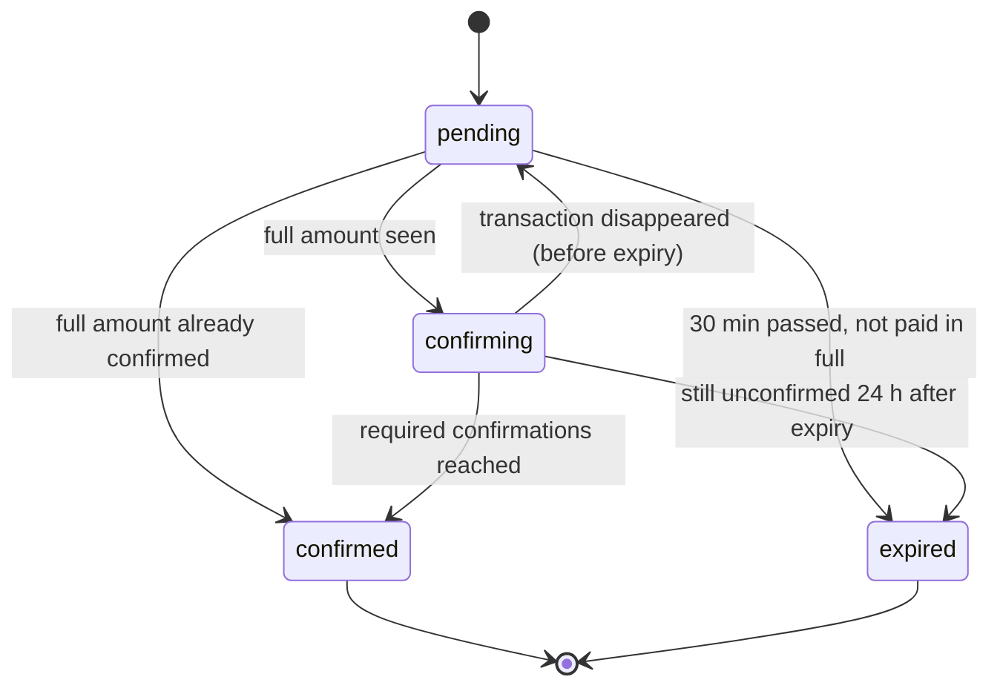

# API reference

Base URL: wherever the gateway runs (development: `http://localhost:8000`).
Interactive docs (OpenAPI): `/api/docs`.

All responses are JSON. Errors use FastAPI's shape: `{"detail": {"error": "..."}}`, or
`{"detail": {"errors": {...}}}` for per-field errors.

- [Authentication](#authentication)
- [Assets](#assets)
- Accounts: [`POST /accounts`](#post-accounts), [`GET /accounts/me`](#get-accountsme)
- Payments: [`POST /payments`](#post-payments), [`GET /payments/{id}`](#get-paymentsid), [`GET /payments`](#get-payments), [statuses](#payment-statuses)
- Wallet: [sign-in, balances, new API key](#wallet)
- Webhooks: [`PUT /accounts/me/webhook`](#put-accountsmewebhook), [`DELETE /accounts/me/webhook`](#delete-accountsmewebhook), [events and signatures](#webhooks)

## Authentication

Send the API key as a bearer token:

```
Authorization: Bearer gw_...
```

The key is shown once, at account creation. Only its SHA-256 hash is stored, so it can't be shown
again. A lost key is replaced from the wallet: sign in there and use
[`POST /accounts/me/api-key`](#post-accountsmeapi-key).

Every authenticated endpoint also accepts a **wallet session** token (`Authorization: Bearer gws_...`),
which the wallet page gets by [signing in](#wallet). It expires after 12 hours.

## Assets

| `chain` | `asset` | Decimals | Confirmations | Address from xpub | Token contract |
|---|---|---|---|---|---|
| `BTC` | `BTC` | 8 | 2 | BTC | — |
| `LTC` | `LTC` | 8 | 6 | LTC | — |
| `DOGE` | `DOGE` | 8 | 6 | DOGE | — |
| `ETH` | `ETH` | 18 | 12 | ETH | — |
| `ETH` | `USDT` | 6 | 12 | ETH | `0xdAC17F958D2ee523a2206206994597C13D831ec7` |
| `BSC` | `BNB` | 18 | 15 | ETH | — |
| `BSC` | `USDT` | 18 | 15 | ETH | `0x55d398326f99059fF775485246999027B3197955` |
| `TRX` | `TRX` | 6 | 20 | TRX | — |
| `TRX` | `USDT` | 6 | 20 | TRX | `TR7NHqjeKQxGTCi8q8ZY4pL8otSzgjLj6t` |

- Amounts are always **decimal strings** (`"12.50"`), never numbers, so nothing gets rounded by a JSON float.
- USDT on BSC has 18 decimals, unlike USDT on Ethereum and Tron (6).
- TRX "20 confirmations" means the block is solidified (irreversible), which Tron reaches after about 19 blocks (~1 minute).
- Only the token contracts above are counted. A token with the same name at another contract is ignored.

---

## `POST /accounts`

Create an account from account-level BIP44 xpubs. No authentication.

**Request**

```json
{
  "xpubs": {
    "BTC": "xpub6CzDCPbtLrrn4VpVbyyQ…",
    "ETH": "xpub6Cp1sx494AvnHH8Z4sCJ…"
  }
}
```

- 1 to 5 entries. Keys are xpub families: `BTC`, `LTC`, `DOGE`, `ETH` (also used for BSC), `TRX`. Case-insensitive.
- Each value must be an **account** xpub: depth 3, hardened child (`m/44'/coin'/account'`).

**201 Created**

```json
{
  "account_id": 3,
  "api_key": "gw_X-t54He-xRd_U5-7Q_bXrGu3FDmC1…",
  "plan": "free",
  "chains": {
    "BTC": { "first_address": "1Di3Vp7tBWtyQaDABLAjfWtF6V7hYKJtug" },
    "ETH": { "first_address": "0xe5815d5902Ad612d49283DEdEc02100Bd44C2772", "also_used_for": ["BSC"] }
  }
}
```

`api_key` appears only in this response. `first_address` is `m/44'/coin'/account'/0/0`, so the
merchant can check it against their wallet.

**400 Bad Request**: one or more xpubs are invalid. Nothing is stored.

```json
{ "detail": { "errors": { "BTC": "this is a PRIVATE key. Never share it. Paste the xpub (public key) instead" } } }
```

| Message | Cause |
|---|---|
| `unsupported chain 'X'` | Key isn't one of the 5 xpub families |
| `not an extended public key …` | Empty, too long, bad characters/checksum, or wrong length |
| `this is a PRIVATE key …` | `xprv`, `Ltpv`, `dgpv`, `yprv`, `zprv` header |
| `unsupported key type: use a BIP44 xpub (not ypub/zpub)` | Any other header, e.g. `ypub`, `zpub` |
| `wrong level: use the account xpub …` | Not depth 3, or the last step isn't hardened |

**409 Conflict**: one of the xpubs is already registered. The existing account is never revealed.

**422 Unprocessable Entity**: the body isn't `{"xpubs": {…}}` with 1 to 5 string entries.

---

## `GET /accounts/me`

Authenticated. Returns the account that owns the key.

```json
{
  "account_id": 3,
  "plan": "free",
  "plan_expires_at": null,
  "webhook_url": "https://shop.example/hooks/crypto",
  "api_key_hint": "gw_Xk3a",
  "api_key_used_at": "2026-11-26T15:02:11Z",
  "settings_need_wallet": true,
  "chains": { "ETH": { "first_address": "0xe5815d…2772", "also_used_for": ["BSC"] } }
}
```

- `api_key_hint`: the first 7 characters of the current API key, to tell which key a shop has. `null`
  for keys made before hints existed.
- `api_key_used_at`: the last request made with the API key (updated at most once a minute), or `null`.
- `settings_need_wallet`: `true` once the account has signed in to the wallet. From then on the webhook
  and the API key can only be changed with a wallet session ([Settings protection](#settings-protection)).

**401**: missing or invalid key.

### Settings protection

`PUT` and `DELETE /accounts/me/webhook` and `POST /accounts/me/api-key` answer **403**
`this needs the wallet sign-in…` when called with an API key on an account that has signed in to the
wallet. A leaked API key can then only create and read payments: it can't redirect or stop webhooks,
and it can't replace the key to lock the shop out. Accounts that never signed in to the wallet
(xpub-only accounts, whose phrase isn't in our wallet) can still use the API key for these.

---

## `POST /payments`

Authenticated. Create a payment and get a receive address for it.

**Request**

```json
{ "chain": "TRX", "asset": "USDT", "amount": "12.50", "reference": "order-1042" }
```

| Field | Required | Notes |
|---|---|---|
| `chain`, `asset` | yes | A pair from [Assets](#assets). Case-insensitive. |
| `amount` | yes | Decimal **string**, > 0, at most the asset's decimals. |
| `reference` | no | Your own order id, up to 100 characters. Returned as-is, never interpreted. |
| `return_url` | no | Where "Back to {shop}" on the checkout page leads once the payment is paid or expired. `https://` only (`http://localhost` for development), up to 500 characters. Only ever a link the payer clicks, never a redirect. |

**Header `Idempotency-Key`** (optional, up to 100 characters, e.g. your order id plus attempt): retrying the same request with the same key within 24 h returns the **same payment** (**200** and `Idempotent-Replayed: true` instead of 201), so a timeout or a double click can't create two payments for one order. The same key with a different body gets **409**.

**201 Created**: the payment object.

```json
{
  "id": "pay_iS2n5H0pWQ3kq1HcX9yN0A",
  "status": "pending",
  "chain": "TRX",
  "asset": "USDT",
  "address": "TA891Fu7vVz595BGQpNX2MCzr7yBcxuoC7",
  "amount": "12.5",
  "amount_received": "0",
  "amount_confirmed": "0",
  "confirmations_required": 20,
  "token_contract": "TR7NHqjeKQxGTCi8q8ZY4pL8otSzgjLj6t",
  "reference": "order-1042",
  "created_at": "2026-11-22T19:05:11Z",
  "expires_at": "2026-11-22T19:35:11Z",
  "confirmed_at": null,
  "transactions": [],
  "address_url": "https://tronscan.org/#/address/TA891Fu7vVz595BGQpNX2MCzr7yBcxuoC7",
  "checkout_url": "https://pay.example.com/pay/pay_iS2n5H0pWQ3kq1HcX9yN0A"
}
```

`transactions`: incoming transactions to the address, oldest first, as
`{"hash": "…", "url": "<explorer link>"}`. Filled in when the watcher sees the amount go up. Always
empty for **native ETH and BNB** (also Sepolia ETH): a plain JSON-RPC node can't search transfers by
address. It can also stay empty if the lookup failed. In those cases `address_url` (the address on
the block explorer) lists them. Explorers: Blockchair (BTC/LTC/DOGE), Etherscan, BscScan, Tronscan.

Send the customer to `checkout_url` (see [Checkout page](#checkout-page)), or show `address`,
`amount`, `asset` and the network yourself. For tokens, the network matters: USDT sent on the
wrong chain won't be seen.

**400**: unsupported chain/asset, bad amount, too long `reference`, a bad `return_url` or
`Idempotency-Key`, or no xpub registered for that chain (`no LTC xpub is registered on this account`).
**401**: bad key. **409**: `Idempotency-Key` already used for a different payment.

### Prices in USD or EUR

Instead of `chain` + `asset` + `amount`, send a price and let the **payer pick the coin** on the checkout page:

```json
{ "price": "25.00", "currency": "USD", "accept": ["BTC/BTC", "TRX/USDT"], "reference": "order-1042" }
```

| Field | Required | Notes |
|---|---|---|
| `price` | yes | Decimal string above 0, at most 2 decimal places, up to 1,000,000. Stored with 2 decimals. |
| `currency` | yes | `USD` or `EUR` |
| `accept` | no | Which `"CHAIN/ASSET"` the payer may choose. Default: every pair the account has an xpub for. |

**201**: the payment with `"status": "choosing"`, `price`, `currency`, `accept`, `checkout_url`, and `chain`,
`asset`, `address` and `amount` all `null`. The payer has **30 minutes to choose**, after which it shows as
`expired` (no webhook: no address was ever shown, so nothing can arrive).

When the payer chooses, the amount is converted at the current rate and **locked**: the payment gets the
same `id`, its `chain`, `asset`, `address` and `amount`, plus `price`, `currency` and `rate` (the price of
one coin used), and a normal 30-minute window starts. From then on it's an ordinary payment: same
statuses, webhooks and checkout. The coin can't be changed afterwards.

**Rates:** Kraken and Coinbase public tickers, cached 60 s. Where both list a coin they must agree within
2% (their average is used); TRX is only on Kraken. USDT is exactly 1 USD. If no fresh, trusted rate is
available, that coin can't be chosen right now: never a stale or disputed price. Amounts are **rounded
up** to the coin's smallest unit, so the merchant never receives less than the price.

`GET /payments` lists payments still being chosen too (`?status=choosing`).

### Address assignment

Index 0 is the merchant's **main address** (Receive, and gas for sending), so payments on
accounts created from now on start at index 1. Each payment gets the next unused address of the
merchant's xpub (`…/0/index`). Addresses are **never reused**, not even after an unpaid payment
expires.

Our wallet tracks every address it handed out, so it has no gap limit. Other wallets stop scanning
after about 20 unused addresses in a row. If you restore the phrase in one of those, raise its gap
limit (Electrum: `wallet.change_gap_limit(200)` in the console; Sparrow: Settings → Gap limit) or
some payment addresses won't show up there. The coins are safe either way.

---

## `GET /payments/{id}`

Authenticated. Returns the payment object. **404** if it doesn't exist or belongs to another account.

## `GET /payments`

Authenticated. Newest first.

| Query | Default | Notes |
|---|---|---|
| `status` | all | `pending`, `confirming`, `confirmed` or `expired` |
| `limit` | 50 | 1 to 100 |

```json
{ "payments": [ { "id": "pay_…", "status": "confirmed", "…": "…" } ] }
```

## Checkout page

`GET /pay/{id}`: a hosted page for the **payer**. Redirect or link the customer to the payment's
`checkout_url`. No API key: the payment id (128 random bits) is the access token, so treat the
link like the payment itself and only give it to that customer.

The page shows the amount, the network ("USDT on Tron (TRC-20)"), a QR code, the address and
amount with Copy buttons, a countdown to `expires_at`, and a warning to send only that asset on
that network. It refreshes every 5 s and follows the status:

| Status | The payer sees | Address shown |
|---|---|---|
| `pending`, nothing received | "Waiting for your payment…" | yes |
| `pending`, part received | "Received 4 of 10.5 USDT. Send the remaining 6.5 USDT to the same address." | yes, amount = what's left |
| `pending`, time is up | "Time is up. Checking the network for your payment…" (the watcher hasn't decided yet) | no |
| `confirming` | "Payment received. Waiting for N network confirmations. You can close this page." | no |
| `confirmed` | "Paid. Thank you." | no |
| `expired` | Don't send anything; ask the merchant for a new payment (or contact them if part was received) | no |

The address is hidden once sending is no longer useful, so nobody pays into an expired payment.
For a payment priced in USD/EUR the page first shows **Choose how to pay**: each accepted coin with its converted amount ("price unavailable" when there's no trusted rate), then the normal page once one is picked.
Once anything is received, the page links to the address on the block explorer ("View on the block
explorer"). It never shows transaction hashes; those are in the API, webhooks and the wallet only.
QR codes for BTC, LTC and DOGE are BIP21 URIs with the amount (`bitcoin:<address>?amount=0.001`).
For Ethereum, BSC and Tron the QR is the **bare address**: payment URIs there are read
inconsistently by wallets and could send the wrong token.

With a shop name and logo set ([`PUT /accounts/me/shop`](#put-accountsmeshop)) the page shows "Payment to {shop}" and the logo at the top. With a `return_url`, "Back to {shop}" appears once nothing is left to do on the page (paid, confirming or expired).

### `POST /pay/{id}/choose`

Public, like the status endpoint (the payment link is the access token). For a payment priced in
USD/EUR: `{"chain": "TRX", "asset": "USDT"}` picks the coin, locks the rate and returns the checkout data
of the new payment. **400**: not accepted for this payment. **404**: unknown id. **409**: a coin was already
chosen. **410**: not chosen within 30 minutes. **503**: no trusted rate for that coin right now.
While choosing, `GET /pay/{id}/status` returns `status: "choosing"`, `price`, `currency` and `options`:
`[{"chain", "asset", "amount", "available"}]`.

## `GET /pay/{id}/status`

Public, no API key. The data behind the checkout page. **404** if the payment doesn't exist.

```json
{
  "id": "pay_iS2n5H0pWQ3kq1HcX9yN0A",
  "status": "pending",
  "chain": "TRX",
  "asset": "USDT",
  "address": "TA891Fu7vVz595BGQpNX2MCzr7yBcxuoC7",
  "amount": "10.5",
  "amount_received": "4",
  "amount_confirmed": "0",
  "amount_due": "6.5",
  "confirmations_required": 20,
  "token_contract": "TR7NHqjeKQxGTCi8q8ZY4pL8otSzgjLj6t",
  "created_at": "2026-11-23T10:00:00Z",
  "expires_at": "2026-11-23T10:30:00Z",
  "confirmed_at": null,
  "address_url": "https://tronscan.org/#/address/TA891Fu7vVz595BGQpNX2MCzr7yBcxuoC7",
  "server_time": "2026-11-23T10:01:12Z"
}
```

Same fields as the payment object **minus `reference`** (your order data stays private) and `transactions`, plus
`amount_due` (amount minus received, never below 0), `server_time` (so the countdown is right
even when the payer's clock is wrong), `shop_name` and `logo_url` (`/pay/{id}/logo`, or `null`). Don't use it from your server: use the authenticated
`GET /payments/{id}`.

## Wallet

Used by the wallet page (`wallet.html`). Sign-in needs no API key: the wallet proves it owns the
account by signing with the private key of the BTC main address (`m/44'/0'/account'/0/0`), which the
server checks against the stored BTC xpub. Accounts created with xpub keys only (no phrase in our
wallet) keep using their API key.

The dashboard's "New payment" form calls `POST /payments` with the session, so a merchant can
make a checkout link without a shop integration.

### `POST /auth/challenge`

No auth. `{"challenge": "gw-login:…", "expires_at": "…"}`. Valid 5 minutes, single use.

### `POST /auth/login`

```json
{ "xpub": "xpub6C…", "challenge": "gw-login:…", "signature": "3044…" }
```

`xpub`: the account's BTC xpub. `signature`: hex DER ECDSA (secp256k1) over
`sha256("Gateway login\n" + challenge)`. The fixed prefix means a login signature can never be
reused as a transaction signature. **200**: `{"token": "gws_…", "account_id": 1, "expires_at": "…"}`.
**401**: expired/used challenge, no account for this xpub, or bad signature. The challenge is
consumed either way.

### `DELETE /auth/session`

Ends the session in the `Authorization` header (the wallet's Lock button). **204**.

### `POST /accounts/me/api-key`

Wallet session (API key only for accounts that never signed in to the wallet: [Settings protection](#settings-protection)).
Makes a new API key and returns it once: `{"api_key": "gw_…"}`. **The old key stops working immediately.**

### `GET /wallet/balances`

Authenticated. Live balances, per chain/asset the account supports:

```json
{
  "balances": [
    {
      "chain": "TRX", "asset": "USDT",
      "balance": "25.5",
      "complete": true,
      "main_address": "TUEZSdKsoDHQMeZwihtdoBiN46zxhGWYdH",
      "addresses": [ { "address": "TA891F…", "index": 3, "balance": "25.5" } ]
    }
  ]
}
```

- Counted addresses: the main address, plus every payment address that ever received funds. That's
  the whole wallet: we created every address, so there's no gap limit.
- `balance` is the current on-chain balance, unconfirmed included, like any wallet shows. It drops
  when funds are spent, from our wallet or anywhere else.
- `complete: false`: a provider couldn't be reached for at least one address, so the real balance
  may be higher. The wallet shows "≥". Without `BLOCKCYPHER_TOKEN`, BTC/LTC/DOGE often hit
  BlockCypher's rate limit.
- `addresses` lists only addresses holding funds. Results are cached for 60 s per address.

### `POST /wallet/scan`

Authenticated. Checks every address of an `expired` payment that never received anything, for
coins sent long after the payment expired (the watcher stops looking 24 h after expiry). Coins found
are recorded as that payment's `amount_received` (the payment stays `expired`), so they show up in
balances and Send, and `payment.paid_late` is sent. **200**:
`{"checked": 41, "found": 1, "failed": 0}`. `failed` addresses couldn't be read right now; try again
later. One provider request per address, so it can take a while on big accounts. The wallet page's
"Check all payment addresses" button calls it.

### `GET /wallet/send/{chain}`

Authenticated. `chain`: `BTC`, `LTC`, `DOGE` (`"kind": "utxo"`), `ETH`, `BSC`, `SEPOLIA`
(`"kind": "evm"`) or `TRX`, `NILE` (`"kind": "tron"`). Query: `asset` (default: the native coin;
`USDT` on EVM and Tron chains) and `to`, the destination, **required** for Tron and tokens because
fees depend on it. `SEPOLIA` and `NILE` only with `GATEWAY_TESTNETS=1`. Anything else: **400**.
What the wallet frame needs to plan a send. UTXO chains:

```json
{
  "chain": "BTC",
  "utxos": [ { "address": "1Ak8Pff…", "index": 1, "tx_hash": "…", "vout": 0, "value": 100000, "confirmations": 3 } ],
  "fee_per_byte": { "slow": 2, "normal": 5, "fast": 12 },
  "change_index": 0,
  "change_address": "1LqBGSKu…"
}
```

Coins with at least 1 confirmation on the main address and every payment address that ever
received funds. `value` and `fee_per_byte` are in smallest units (satoshis). Change goes back to the
main address. EVM chains:

```json
{
  "chain": "SEPOLIA", "kind": "evm", "asset": "ETH", "chain_id": 11155111, "gas_limit": 21000,
  "fees": {
    "type": "eip1559",
    "slow":   { "max_fee_per_gas": "100000038",  "max_priority_fee_per_gas": "100000000" },
    "normal": { "max_fee_per_gas": "1000000020", "max_priority_fee_per_gas": "999999982" },
    "fast":   { "max_fee_per_gas": "1000000020", "max_priority_fee_per_gas": "999999982" }
  },
  "sources": [ { "address": "0x9858…", "index": 0, "balance": "39999999064069", "nonce": 402 } ]
}
```

`sources`: every wallet address (main + funded payment addresses) with a balance, with its next
nonce. Each sends its own transfer and pays its own fee. Amounts are wei, as strings. Fees: tips are
the 10th/50th/90th percentile of the last 10 blocks (minimum 0.1 gwei), max fee = 2 × next base fee +
tip. BSC returns `"type": "legacy"` with `gas_price` per speed. **502**: the provider couldn't be read.

USDT on EVM adds `"main"` (the main address with its ETH/BNB `balance` and `nonce`; it pays gas)
and lists as `sources` only addresses holding the token, each with `token_balance` and `token_gas`
(`eth_estimateGas` for sending its whole balance to `to`).

Tron (`TRX`, `NILE`):

```json
{
  "chain": "NILE", "kind": "tron", "asset": "TRX",
  "params": { "bandwidth_fee": 1000, "energy_fee": 100, "create_fee": 1100000 },
  "block": { "number": 72971618, "timestamp": 1795457931000, "tx_trie_root": "…", "parent_hash": "…", "witness_address": "41…", "version": 40 },
  "to_active": true,
  "sources": [ { "address": "TUEZ…", "index": 0, "balance": "2000000", "active": true, "bandwidth": 600, "energy": 0 } ]
}
```

Amounts in sun (1 TRX = 1,000,000). `to_active: false` means sending TRX there activates the
address (`create_fee`). `bandwidth` / `energy`: what the address can use today without burning TRX.
USDT adds `"main"` and, per source, `token_balance` and `token_energy` (simulated transfer).

### `POST /wallet/send/{chain}`

Authenticated. `{"txs": ["0100…", …]}`: transactions signed by the wallet frame (1 to 50, hex).
Relayed in order (BlockCypher for UTXO chains, `eth_sendRawTransaction` for EVM, TronGrid
`broadcasthex` for Tron, where each is the signed `Transaction` protobuf), stopping at the
first rejection: `{"chain": "SEPOLIA", "tx_hashes": ["0x…"], "error": null}`. If some went through
before a rejection, `tx_hashes` lists them and `error` says which one failed and why. **502** if the
first one is rejected (for example a fee too low). **422**: not hex.

### `GET /wallet/tx/{chain}/{hash}`

Authenticated; EVM and Tron chains. `{"done": true, "ok": true}` once the transaction is in a block
and succeeded (`ok: false`: included but failed), `{"done": false}` while pending. The wallet page
uses it to wait for gas top-ups before relaying token transfers.

## Payment statuses



| Status | Meaning |
|---|---|
| `pending` | Waiting for the customer. `amount_received` shows partial payments. |
| `confirming` | The full amount arrived in time and is waiting for confirmations. Safe to show "payment received", but **don't ship yet**. |
| `confirmed` | Final. The full amount has the required confirmations. Ship the order. |
| `expired` | Final. The full amount wasn't received within 30 minutes (or never confirmed). `amount_received` may be above 0 for an underpayment. |

- The payment window is **30 minutes** from `created_at`. A payment first seen at the first check after the window closes still counts.
- Overpayments count as paid. Underpayments never do: anything below `amount` stays `pending` and then `expired`.
- Funds that arrive after `expired` still land in the merchant's wallet (it's their address), but the payment stays `expired`. The watcher keeps checking expired payments for **24 hours** (every 15 minutes): new confirmed funds update `amount_received` / `amount_confirmed` and send `payment.paid_late`. Refund or settle those by hand. Anything later is found by [`POST /wallet/scan`](#post-walletscan).
- If the chain provider can't be reached, the payment is **not** expired. It's checked again once the provider answers.

---

## `PUT /accounts/me/webhook`

Wallet session ([Settings protection](#settings-protection)). Set where payment events are sent.
**Every call generates a new secret**, which is returned once.

```json
{ "url": "https://shop.example/hooks/crypto" }
```

**200**

```json
{ "url": "https://shop.example/hooks/crypto", "secret": "whsec_N1u…" }
```

**400**: the URL isn't `https://`, contains credentials, doesn't resolve, or points to a private,
loopback or link-local address.

## `DELETE /accounts/me/webhook`

Wallet session ([Settings protection](#settings-protection)). Stops webhooks. **204**. Events already queued are dropped.

## `PUT /accounts/me/shop`

Wallet session ([Settings protection](#settings-protection)): a leaked API key mustn't be able to rename the shop payers think they're paying. `{"name": "Corner Café", "logo": "data:image/png;base64,…"}`.

- `name`: up to 60 characters on one line; `null` or `""` clears it.
- `logo`: a PNG or JPEG data URL, at most 100 KB, checked against the file's real signature (SVG is refused: it can carry scripts). `null` or `""` removes it; leave the field out to keep the current one.

**200** `{"shop_name": "Corner Café", "has_logo": true}`. The logo is served at `GET /pay/{id}/logo` for each payment, from our own domain, with `Content-Security-Policy: default-src 'none'`. `GET /accounts/me` also returns `shop_name`, `has_logo` and `logo` (the data URL).

## `POST /accounts/me/webhook/test`

Same rule as above. Sends a signed `payment.test` event to the webhook right away and reports how the
shop answered: **200** `{"delivered": true, "error": null}`, or `{"delivered": false, "error": "HTTP 500"}`
(or a timeout or connection error). The payment in it is a sample: its id starts with `pay_test_` and
its `reference` is `test-event`, so it can't be mistaken for a real one. **400** if no webhook is set.
6 per minute.

## `GET /accounts/me/webhook/deliveries`

Authenticated. The account's 20 most recent events, newest first:
`{"deliveries": [{"id", "payment_id", "event", "status", "attempts", "delivered_at", "next_attempt_at", "last_error"}]}`.
`status` is `delivered`, `queued` (not tried yet), `retrying` (failed, will retry) or `failed` (gave up
after the last retry, or the webhook was removed). Test events aren't listed: they're sent at once,
not queued.

## Webhooks

When a payment changes status, the gateway sends:

```http
POST https://shop.example/hooks/crypto
Content-Type: application/json
Gateway-Signature: t=1795369511,v1=5f2c0e…

{"event":"payment.confirmed","payment":{…same object as GET /payments/{id}…}}
```

| Event | When |
|---|---|
| `payment.confirming` | Full amount seen, waiting for confirmations |
| `payment.confirmed` | Final: paid and confirmed |
| `payment.expired` | Final: not paid (or not confirmed) in time |
| `payment.test` | Only from `POST /accounts/me/webhook/test` (the wallet's "Send test event"); a sample payment |
| `payment.paid_late` | More confirmed funds arrived on an `expired` payment. `status` stays `expired`; check `amount_confirmed` and refund or fulfil by hand |

**Delivery:** any `2xx` response counts as delivered. Otherwise the event is retried after 1 min,
5 min, 30 min, 2 h, 6 h and 24 h, then dropped. Redirects aren't followed. The timeout is 10 s.
Events can arrive more than once or out of order, so key your handling on `payment.id` +
`payment.status`, and when in doubt call `GET /payments/{id}`.

**Code samples** that create a payment and verify signatures, in Python, Node.js, PHP and curl, are in
`frontend/public/samples/` and on the wallet's Integration screen. The test suite runs each of them
against the gateway (`tests/e2e/test_samples.py`).

**Verifying the signature** (do this before trusting the body):

`v1` is `HMAC-SHA256(secret, "<t>.<raw body>")` as hex. Use the raw request bytes, not re-encoded
JSON, and reject timestamps more than 5 minutes old.

```python
import hashlib, hmac, time

def verify(secret: str, raw_body: str, header: str, tolerance=300) -> bool:
    fields = dict(p.split("=", 1) for p in header.split(","))
    t = int(fields["t"])
    if abs(time.time() - t) > tolerance:
        return False
    expected = hmac.new(secret.encode(), f"{t}.{raw_body}".encode(), hashlib.sha256).hexdigest()
    return hmac.compare_digest(expected, fields["v1"])
```

```js
const crypto = require("crypto");

function verify(secret, rawBody, header, tolerance = 300) {
  const fields = Object.fromEntries(header.split(",").map((p) => p.split("=", 2)));
  const t = Number(fields.t);
  if (Math.abs(Date.now() / 1000 - t) > tolerance) return false;
  const expected = crypto.createHmac("sha256", secret).update(`${t}.${rawBody}`).digest("hex");
  return expected.length === fields.v1.length &&
    crypto.timingSafeEqual(Buffer.from(expected), Buffer.from(fields.v1));
}
```

---

## Rate limits

Past a limit the server answers **429** `{"detail": {"error": "too many requests; try again in N s"}}`
with a `Retry-After` header (seconds). Sliding windows:

| What | Limit | Counted per |
|---|---|---|
| `POST /accounts` (sign-up) | 5 per hour | IP |
| `POST /auth/challenge`, `POST /auth/login` | 20 per minute (together) | IP |
| `POST /payments` | 60 per minute | account |
| `GET /pay/{id}/status` (checkout page polls every 5 s) | 120 per minute | IP |
| `GET /wallet/balances`, `GET`/`POST /wallet/send/{chain}` | 30 per minute (together) | account |
| `GET /wallet/tx/{chain}/{hash}` (polled while gas top-ups land) | 60 per minute | account |
| `POST /wallet/scan` | 1 per minute | account |

Counts live in the server's memory: they reset on restart and assume one server process (several
processes or servers: limit at the reverse proxy instead). Behind a reverse proxy, set
`GATEWAY_TRUST_PROXY=1` so the visitor's IP is read from `X-Forwarded-For` ([setup.md](setup.md)).

## Response headers

Every response: `Content-Security-Policy: frame-ancestors 'self'`, `X-Content-Type-Options: nosniff`,
`Referrer-Policy: no-referrer`. `/accounts*`, `/payments*`, `/pay/*`, `/auth*` and `/wallet*` also send `Cache-Control: no-store`.

## Example session

```powershell
$h = @{ Authorization = "Bearer gw_YOUR_KEY" }
Invoke-RestMethod -Method Post http://localhost:8000/payments -Headers $h -ContentType "application/json" -Body '{"chain":"TRX","asset":"USDT","amount":"12.50","reference":"order-1042"}'
Invoke-RestMethod http://localhost:8000/payments/pay_XXXX -Headers $h
```
