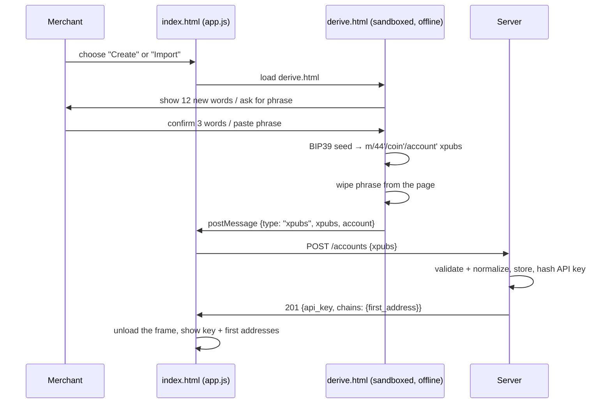
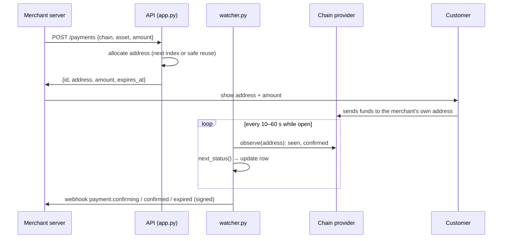

# Architecture

## Components

```
Browser (frontend/public)                               Server (backend/)
┌─────────────────────────────────────────────┐         ┌──────────────────────────────┐
│ index.html + app.js   (can reach our server) │  JSON   │ app.py (FastAPI)             │
│   │                                          │ ──────▶ │  /accounts  /payments        │
│   │ postMessage({type:"xpubs"})              │         │  /accounts/me/webhook        │
│ ┌─▼──────────────────────────────────────┐   │         │  serves frontend/public      │
│ │ derive.html  sandboxed iframe           │   │         └──────────────┬───────────────┘
│ │ - no network (CSP connect-src 'none')   │   │                        │
│ │ - opaque origin (sandbox=allow-scripts) │   │                 SQLite (gateway.db)
│ │ - phrase → BIP39 seed → 5 account xpubs │   │                        │
│ └─────────────────────────────────────────┘   │         ┌──────────────┴───────────────┐
│ xpub.html + app.js    (paste xpubs directly) │         │ watcher.py (separate process)│
└─────────────────────────────────────────────┘         │  chain_client → providers    │
                                                         │  payments.next_status()      │
Merchant's server ◀──── signed webhooks ──────────────── │  webhooks.deliver_due()      │
                                                         └──────────────────────────────┘
```

Two design rules:
1. **Code that can talk to the network never sees a recovery phrase, and code that sees the phrase can't talk to the network.** See [security.md](security.md).
2. **The server never holds anything that can move funds.** It only derives addresses from xpubs and reads balances.

## Onboarding flows

### Create a new wallet / import a phrase



- New wallets derive **account 0**: the wallet is dedicated to payments, so using the account every wallet shows is simplest.
- Imported phrases default to **account 1** (changeable under "Advanced") so payments stay separate from the wallet's everyday account 0. An optional BIP39 passphrase is supported.
- The frame resizes itself via `postMessage({type: "height"})` and reports load failures via `{type: "frame-error"}`.
- **Blocked-frame fallback:** the parent shows "Loading the secure phrase window…" until the frame's first message. If nothing arrives within 12 s, the browser blocked sandboxed scripts: the parent hides the frame and tells the user to switch browsers or use xpub keys. Known case: the Claude desktop app's preview browser, which never runs scripts in sandboxed iframes. Verified working in Chrome.

### Use xpub keys

`xpub.html` posts the pasted xpubs straight to `POST /accounts`. Server validation errors come back per chain and are shown under the matching field.

### Checking the result

Every success response includes the first receive address (`m/44'/coin'/account'/0/0`) for each chain. The merchant compares it with their wallet, which catches a wrong account number or a wrong xpub before any money moves.

## Payments



### Address allocation (`payments.create`)

Inside one `BEGIN IMMEDIATE` transaction, so two requests can't take the same new index:

1. Look for a **reusable** address: every payment ever made on it was for the same chain/asset, all of them `expired` with `received = 0`, and the latest expired over 24 h ago.
2. Otherwise take `account_xpubs.next_index` and increment it.

Reuse exists for the wallet gap limit (wallets stop scanning after ~20 unused addresses). A quick burst of 20+ unpaid payments within 24 h can still exceed it. The funds are safe either way, but the merchant may need to raise their wallet's gap limit (Electrum: `wallet.change_gap_limit(100)`).

### Watcher (`watcher.py`)

One pass (`tick`) every 5 s:
1. Load open payments whose `next_check_at` has passed.
2. `chain_client.observe()` returns `(seen, confirmed)` in smallest units.
3. `payments.next_status()`, a pure function, decides the new status (rules in [api.md](api.md#payment-statuses)).
4. Store amounts and status. On a change, queue a webhook event in the same transaction.
5. `webhooks.deliver_due()` sends queued events and schedules retries.

Per-chain pacing (`payments.CHECK_EVERY`): BTC/LTC/DOGE 60 s (BlockCypher rate limits), ETH 15 s, BSC and TRX 10 s. A provider error never changes a payment's status. The payment is simply retried on schedule.

Only one watcher runs per database: `single_instance()` holds an OS file lock
(`<db>.watcher.lock`), released automatically even on a crash. It can run as a service, or from
cron with `--max-seconds` on hosts that kill long jobs. SIGTERM finishes the current pass before
exiting. See [setup.md](setup.md#run-locally).

### How "received" is measured (`chain_client.py`)

| Chain | Provider | Seen | Confirmed |
|---|---|---|---|
| BTC, LTC, DOGE | BlockCypher `/addrs/{a}` | Sum of outputs to the address, confirmed + unconfirmed | Outputs with ≥ N confirmations |
| ETH, BSC (native) | JSON-RPC `eth_getBalance` | Balance at `latest` | Balance at block `latest − N + 1` |
| ETH, BSC (USDT) | JSON-RPC `eth_call balanceOf` | Same, at `latest` | Same, at `latest − N + 1` |
| TRX (native) | TronGrid `getaccount` | `wallet/` (latest block) | `walletsolidity/` (irreversible) |
| TRX (USDT) | TronGrid `triggerconstantcontract balanceOf` | `wallet/` | `walletsolidity/` |

Reading the balance as of block `latest − N + 1` gives exactly the funds with at least N
confirmations, with no transaction scanning. Balance equals "received" because payment addresses
are fresh, or reused only after receiving nothing, and watching stops once a payment is final.

## Key derivation

| Chain | Path | xpub prefix | Address type |
|---|---|---|---|
| BTC | `m/44'/0'/a'` | `xpub` | P2PKH (`1…`) |
| LTC | `m/44'/2'/a'` | `Ltub` (frame) / `xpub` (accepted) | P2PKH (`L…`) |
| DOGE | `m/44'/3'/a'` | `dgub` | P2PKH (`D…`) |
| ETH, BSC | `m/44'/60'/a'` | `xpub` | `0x…` (same address on both chains) |
| TRX | `m/44'/195'/a'` | `xpub` | `T…` |

Receive addresses are `…/0/index`. The server derives them with `bip_utils`. The browser derives
xpubs with the bitcoinjs bundled from Ian Coleman's tool. Both were checked against each other and
against that tool's test vectors.

## Data model

SQLite, in `db.py`. Every `*_at` column is UTC `YYYY-MM-DDTHH:MM:SSZ`, so strings sort by time.
Amounts are integers in smallest units, **stored as text**, because 100 ETH in wei doesn't fit in
SQLite's 64-bit integer.

```
accounts                              account_xpubs
- id                PK                - account_id   FK → accounts.id
- api_key_hash      UNIQUE (sha256)   - chain        BTC | LTC | DOGE | ETH | TRX
- plan, plan_expires_at               - xpub         UNIQUE, normalized
- created_at                          - next_index   next never-used address index
- webhook_url, webhook_secret         PK (account_id, chain)

payments                              webhook_events
- id                PK "pay_…"        - id               PK
- account_id        FK                - account_id, payment_id
- chain, asset, xpub_chain            - event            payment.confirming|confirmed|expired
- address_index, address              - body             exact signed JSON
- amount, received, received_confirmed (text ints)
- status            pending|confirming|confirmed|expired
- reference                           - attempts, next_attempt_at (NULL = done)
- created_at, expires_at, confirmed_at, updated_at, next_check_at
                                      - delivered_at, last_error
```

`db.init()` runs on API start and watcher start. It creates missing tables and adds columns
introduced after 0.1.0 (`MIGRATIONS`), so existing databases keep their accounts. WAL mode lets
the API and the watcher write at the same time.

## File map

| File | Role |
|---|---|
| `backend/app.py` | API routes, security headers, serves `../frontend/public` |
| `backend/db.py` | Connection, schema, migrations, timestamp helpers |
| `backend/xpubs.py` | `normalize()` (validate + fix version bytes) and `address()` |
| `backend/assets.py` | Supported chain/asset pairs, decimals, confirmations, token contracts, amount parsing |
| `backend/payments.py` | Address allocation, `next_status()` state machine, webhook queueing, API shape |
| `backend/chain_client.py` | Read-only provider queries (`observe`) |
| `backend/webhooks.py` | URL safety checks, HMAC signing/verifying, delivery with retries |
| `backend/watcher.py` | Background loop tying the above together; single-instance lock, cron mode |
| `backend/test_xpubs.py`, `backend/test_payments.py` | Self-checks |
| `frontend/build_frame.py` | Inlines `frame/` + `public/styles.css` into `public/derive.html`, pins CSP hashes |
| `frontend/frame/derive.src.html`, `frontend/frame/derive.js` | Seed frame source (UI + derivation) |
| `frontend/frame/sandbox-shim.js` | In-memory `localStorage` (sandboxed frames can't touch storage) + error reporting |
| `frontend/frame/vendor/` | Unmodified BIP39 engine from Ian Coleman's tool, with `SHA256SUMS` |
| `frontend/public/index.html`, `xpub.html`, `app.js`, `styles.css` | Onboarding pages |
| `frontend/public/derive.html` | **Generated** seed frame (don't edit) |
| `frontend/public/tools/payment-xpub-tool.html` | Downloadable offline xpub tool (built from `xpub_tool/`) |
| `xpub_tool/` | Standalone offline xpub tool: Ian Coleman's BIP39 tool v0.5.6 with `payments:` changes |

## Relation to the old code

The project started as a custodial deposit system: a master `SEED_PHRASE` on the server, private
keys derived per deposit, funds swept to a main wallet. That code was removed (the last commit
containing it is `b18a440`). What was worth keeping (provider endpoints, the cron-friendly
single-instance watcher, transaction-hash lookups, monitoring queries) is either in the code or in
[roadmap.md](roadmap.md). `chain_client.py` uses the same providers (BlockCypher, Alchemy/Ankr,
TronGrid) with a smaller, corrected client. The old one read BSC USDT with 6 decimals instead of 18,
accepted 1% underpayments, and sent base58 Tron addresses where hex was required.
