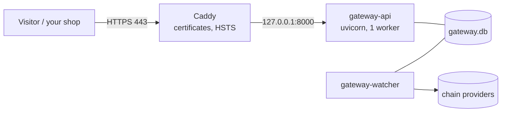

# Deploying to a staging server

A step-by-step guide for one small Linux server (VPS) with HTTPS: enough for the real-money mainnet
test, and the same setup production would use. Config files are in [`deploy/`](../deploy).
Settings are explained in [setup.md](setup.md#providers).



## What you need

| | Notes |
|---|---|
| A VPS | Ubuntu 24.04, 1 vCPU, 1 GB RAM is plenty (Hetzner CX22, DigitalOcean, Vultr: about $5/month). Add your SSH key when creating it. |
| A domain name | For testing, a free [DuckDNS](https://www.duckdns.org) subdomain (`yourname-pay.duckdns.org`) works. For production, buy a real domain (Cloudflare, Porkbun, Namecheap: about $10/year). |
| Provider keys | Mainnet needs real ones: `ETH_RPC_URL` (Alchemy free plan), `BSC_RPC_URL` (Ankr or another BSC RPC), `BLOCKCYPHER_TOKEN` (free account), `TRONGRID_API_KEY` (free). |
| A wallet for the test | Use a **new** recovery phrase on the staging server, not your Sepolia/Nile test one and not your personal wallet. |

## 1. Point the domain at the server

Create the VPS and note its IPv4 address. Then:

- **DuckDNS:** sign in, add a subdomain, put the server's IP in "current ip", press "update ip".
- **Own domain:** add an `A` record for `pay` (or whatever subdomain) pointing at the IP.

Check from your PC (it can take a few minutes):

```powershell
Resolve-DnsName YOUR_DOMAIN
```

## 2. Basic server setup

Log in from your PC:

```powershell
ssh root@YOUR_SERVER_IP
```

Then on the server (everything from here on runs there, as root):

```bash
apt update && apt -y upgrade
apt -y install python3-venv python3-pip git sqlite3 ufw unattended-upgrades debian-keyring debian-archive-keyring apt-transport-https curl
ufw allow OpenSSH && ufw allow 80 && ufw allow 443 && ufw --force enable
adduser --system --group --home /opt/gateway gateway
```

The firewall leaves only SSH and the web ports open. The app itself listens on `127.0.0.1:8000`,
which is unreachable from outside.

## 3. Get the code

Give the server a read-only **deploy key** (needed if the repository is private, and safer than your
own credentials either way):

```bash
sudo -u gateway mkdir -p -m 700 /opt/gateway/.ssh
sudo -u gateway ssh-keygen -t ed25519 -N "" -f /opt/gateway/.ssh/id_ed25519
cat /opt/gateway/.ssh/id_ed25519.pub
```

On GitHub: the repository → Settings → Deploy keys → Add deploy key → paste it, leave "Allow write
access" **off**. Then:

```bash
sudo -u gateway git clone git@github.com:Macanthony7/Vori.git /opt/gateway/app
sudo -u gateway python3 -m venv /opt/gateway/venv
sudo -u gateway /opt/gateway/venv/bin/pip install -r /opt/gateway/app/backend/requirements.txt
```

(If GitHub asks to confirm the host fingerprint, type `yes`.) The code now sits in
`/opt/gateway/app`, which is where the service files expect it.

## 4. Settings

```bash
cd /opt/gateway/app/backend
sudo -u gateway cp .env.example .env
chmod 600 .env
python3 -c "import secrets; print(secrets.token_hex(32))"
nano .env
```

In `.env`:

- Fill in the provider keys from [What you need](#what-you-need).
- `GATEWAY_DB_KEY=` the 64 characters the `python3` line printed. **Copy this value into your password
  manager now.** Without it the database's xpubs can't be read ([security.md](security.md#database)).
- `GATEWAY_PUBLIC_URL=https://YOUR_DOMAIN`
- `GATEWAY_TRUST_PROXY=1`
- Leave `GATEWAY_TESTNETS` and `GATEWAY_ALLOW_PRIVATE_WEBHOOKS` commented out. The mainnet test should
  look exactly like production.

Save (Ctrl+O, Enter, Ctrl+X). Then create the database once, before starting the services:

```bash
sudo -u gateway /opt/gateway/venv/bin/python -c "import db; db.init()"
```

## 5. Start the API and the watcher

```bash
cp /opt/gateway/app/deploy/gateway-api.service /opt/gateway/app/deploy/gateway-watcher.service /etc/systemd/system/
systemctl daemon-reload
systemctl enable --now gateway-api gateway-watcher
systemctl status gateway-api gateway-watcher --no-pager
curl -s -o /dev/null -w "%{http_code}\n" http://127.0.0.1:8000/
```

Both should be `active (running)` and the `curl` should print `200`. Both restart by themselves after
a crash or a reboot.

## 6. HTTPS with Caddy

Install Caddy from its official repository:

```bash
curl -1sLf 'https://dl.cloudsmith.io/public/caddy/stable/gpg.key' | gpg --dearmor -o /usr/share/keyrings/caddy-stable-archive-keyring.gpg
curl -1sLf 'https://dl.cloudsmith.io/public/caddy/stable/debian.deb.txt' | tee /etc/apt/sources.list.d/caddy-stable.list
apt update && apt -y install caddy
sed "s/YOUR_DOMAIN/your-real-domain.duckdns.org/" /opt/gateway/app/deploy/Caddyfile > /etc/caddy/Caddyfile
systemctl reload caddy
```

(Put your domain in the `sed` line.) Caddy fetches a Let's Encrypt certificate on the first request.
Open `https://YOUR_DOMAIN` in your browser: you should see the sign-up page with a valid padlock.

## 7. Backups

The database and the key are backed up **separately**: either one alone is useless to a thief.

```bash
mkdir -p /var/backups/gateway && chown gateway:gateway /var/backups/gateway && chmod 700 /var/backups/gateway
echo '15 3 * * * gateway sqlite3 /opt/gateway/app/backend/gateway.db ".backup /var/backups/gateway/gateway-$(date +\%F).db" && find /var/backups/gateway -name "*.db" -mtime +14 -delete' > /etc/cron.d/gateway-backup
```

That makes a consistent copy every night at 03:15 and keeps 14 days. To also copy the backups off the
server, use your VPS provider's snapshot feature or `scp` them to your PC from time to time. The key
stays in your password manager only.

## 8. The mainnet test (with real money, by you)

Keep the amounts small: if something goes wrong, the loss is a few dollars of fees. The gateway never
holds the coins, but a mistake in sending them back could still send them somewhere wrong.

1. On `https://YOUR_DOMAIN`, create a **new** wallet. Write the recovery phrase down on paper.
2. Unlock the wallet page. Under **New payment**, create a payment for each of these and pay it from
   your personal wallet or an exchange:

   | Payment | Amount | Watch for |
   |---|---|---|
   | TRX on Tron | 5 TRX | Paid within about a minute (20 confirmations ≈ 60 s) |
   | USDT on Tron | 2 USDT | Paid, and "View" in Recent payments opens the transaction on Tronscan |
   | ETH on Ethereum | about $5 | Paid after about 1 minute; "View" opens the address on Etherscan |
   | BTC (optional) | about $5 | Paid after 2 confirmations, about 20 minutes |

3. For the gas top-up test, put about 15 TRX on your main Tron address (Receive), then **Send** the
   USDT back to your personal wallet. The confirm screen should show one gas top-up. For a brand-new
   payment address it includes about 1.1 TRX to activate it.
4. **Send** the TRX and ETH back too. Each Send shows the fee before you confirm.
5. Check on the explorers that everything arrived where you sent it.

Tell me how each step went. If anything looks wrong, stop and send me what the page showed.

## Updating

```bash
cd /opt/gateway/app
sudo -u gateway sqlite3 backend/gateway.db ".backup /var/backups/gateway/before-update.db"
sudo -u gateway git pull
sudo -u gateway /opt/gateway/venv/bin/pip install -r backend/requirements.txt
systemctl restart gateway-api gateway-watcher
```

Database changes are applied automatically on start.

## When something's wrong

| Check | Command |
|---|---|
| API log | `journalctl -u gateway-api -n 100 --no-pager` (live: `-f`) |
| Watcher log (payments being checked, provider errors) | `journalctl -u gateway-watcher -n 100 --no-pager` |
| Caddy / certificate log | `journalctl -u caddy -n 100 --no-pager` |
| Restart everything | `systemctl restart gateway-api gateway-watcher caddy` |

- **No certificate:** the domain doesn't point at the server yet, or port 80 is blocked. Caddy needs
  both for Let's Encrypt.
- **Payments stay "Waiting" after paying:** look for provider errors in the watcher log. Usually a
  wrong RPC URL or a missing or rate-limited key.
- **429 Too Many Requests for everyone:** `GATEWAY_TRUST_PROXY=1` is missing, so every visitor counts
  as Caddy's IP.
