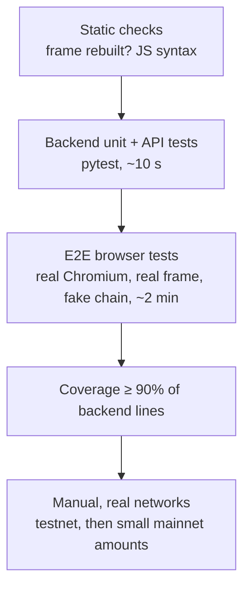

# Testing

How every change is tested before it's committed: the test layers, the one command that runs them,
coverage, and the manual checks that need real networks. The build plan with each feature's tests:
[plan.md](plan.md).

## One command

From the repository root:

```powershell
python run_tests.py
```

```powershell
python run_tests.py --fast
```

`--fast` skips the browser tests: use it while working, and run the full one before every commit.
Both stop at the first failure. The full run takes about 10 to 15 minutes on a laptop (most of it is the 600,000-round password hashing in each browser test's unlock). CI runs the same command on every
push and pull request ([.github/workflows/tests.yml](../.github/workflows/tests.yml)).

First time only:

```powershell
pip install -r backend/requirements.txt -r requirements-dev.txt
```

The browser tests use Playwright's Chromium if it's installed (`python -m playwright install chromium`),
otherwise the Edge or Chrome already on the machine. No API keys, no network, no real database:
everything runs against a temporary database and a fake blockchain.

## The layers



| Layer | Files | What it proves |
|---|---|---|
| Static | `frontend/build_frame.py --check`, `node --check` | `derive.html` matches its sources (nobody edited `frame/` without rebuilding, or edited the built file by hand); every script parses |
| Unit: addresses | `backend/test_xpubs.py` | All 5 xpub families derive the reference addresses; private keys, wrong versions, depths and checksums are refused |
| Unit: rates | `backend/test_rates.py` | Kraken/Coinbase parsing, the 2% agreement rule, single-source coins, USDT = 1 USD, 60 s cache, failures not cached, rounding up |
| Unit: providers | `backend/test_chain_client.py` | BlockCypher, JSON-RPC and TronGrid answers are parsed right: amounts, confirmations, fee math, transaction hashes, errors, and API keys never in error messages |
| API + watcher | `backend/test_payments.py` | Every endpoint and error, rate limits, encryption at rest and its migration, every payment status transition, paid late, scan, webhooks and retries, no address reuse |
| Hooks and compression | `backend/test_hooks.py` | BlockCypher hooks made only for open BTC/LTC/DOGE payments and only once, removed when final (retried on failure), 10-minute polling while hooked and normal polling without; the callback needs its secret and never changes amounts or status; the hook requests' shape; the signing engine served gzipped (at least halved) with its SHA-256 pins intact |
| Watcher process | `backend/test_watcher.py` | One watcher per database, `--once`, `--max-seconds`, surviving a failing pass |
| E2E | `tests/e2e/test_*.py` | What a person does, in a real browser against the real server: see below |

### E2E (end to end)

`tests/e2e/conftest.py` starts the real API inside the test process (temporary database, random
`GATEWAY_DB_KEY`) and replaces every blockchain call with `tests/e2e/fakechain.py`. Tests set
balances and payments on the fake chain and run watcher passes themselves (`tick()`), so nothing
depends on timing or a network. Each test gets a fresh browser profile (its own saved wallet).

| File | Flows |
|---|---|
| `test_onboarding.py` | Create a wallet (12 words, backup check, password rules) → API key; import a phrase; same phrase on a second device = restore, not a second account; invalid phrase; xpub sign-up errors |
| `test_wallet_checkout.py` | Unlock, balances, Receive (QR); **Lock really reloads the frame**, wrong password; New payment → checkout page → partly paid → paid → confirmed, no hashes on the payer's page; Recent payments; expired + late coins found by the scan; API key rotation; webhook body; checkout on a phone (375 px, no sideways scrolling) |
| `test_settings.py` | Webhooks screen against a real local receiver: bad URL, save (secret once), test event signed with that secret, HTTP 500 reported, a real event in Recent deliveries, remove; Integration screen samples in all 4 languages |
| `test_samples.py` | The merchant code samples (Python, Node.js, PHP, curl) create a payment on the test server, and each verifier accepts a real signature and rejects altered, wrong-secret, replayed and junk ones |
| `test_shop.py` | Shop name and logo set in the wallet (oversized logo refused), shown on the checkout page; the logo really renders; 58-character name fits a phone; "Back to shop" hidden while paying, shown after; removing them |
| `test_price.py` | Price in USD from the wallet form → checkout shows **Choose how to pay** with converted amounts, coins without a rate disabled, fits a phone → pick TRX → address and locked amount → paid → Recent payments shows "= 25.00 USD" |
| `test_design.py` | The redesign: wallet tabs by keyboard (arrows, Home/End), sign-up by keyboard only, a visible focus ring, no sideways scrolling at 320 and 375 px on every page and wallet tab, payments search and status filter with the no-match state, and **screenshot comparison** of the checkout states (choosing, waiting, partly paid, seen, paid; light and dark) |
| `test_send.py` | Send BTC (with change), ETH, TRX to a new address, USDT on Tron with a gas top-up; the frame refuses an address the server planted |

Every signed transaction is decoded by `tests/e2e/decode.py`, written from the formats' specs and
independent of the frame's code: it recovers the **signer** from the signature (EVM, Tron) or checks
the input's public key (Bitcoin), then checks amounts, recipient, change, chain id, nonce, gas and the
Tron fee limit. A bug in the frame can't hide in both places.

### Screenshot comparison

`test_design.py` compares the checkout states with approved images in
`tests/e2e/goldens/<os>-<browser><major>/`. Rendering differs between machines and browsers, so each
environment keeps its own set: a missing image is recorded (the test reports it as skipped) and becomes the
approved look. When a test fails because the look changed, it writes `<name>.actual.png` next to the golden;
if the change is intended, delete the golden and run again. Parts that change every run (QR, address,
countdown, payment id) are masked and animations are disabled. Commit the goldens of the machine you design
on; CI's Chromium records its own on each run (nothing to compare there until goldens for it are committed).

## Coverage

`run_tests.py` measures backend line coverage across all suites (the E2E server runs in the test
process, so browser tests count) and **fails below 90%** (`COVERAGE_MIN`). The line-by-line report is
in `htmlcov/index.html` after a run (CI keeps it as the `coverage-html` artifact).

What isn't measured: the JavaScript (`wallet.js`, `pay.js`, `app.js`, the frame). The E2E tests cover
it by behavior instead. Add JavaScript coverage (Chromium's built-in coverage via Playwright) if a
frontend bug ever gets through.

Raise `COVERAGE_MIN` when coverage grows. Never lower it to make a change pass: add the missing test.

## The process for every change

1. **Plan:** the change's entry in [plan.md](plan.md) lists what "done" means and which tests prove it.
   Agree on it before writing code.
2. **Test with the change:** new behavior gets tests in the same change.
   - Backend logic or a new endpoint: a test in `backend/` (happy path, each error, the security rule).
   - Anything a person clicks: an E2E test.
   - Anything that signs: the E2E test decodes the transaction with `decode.py`.
   - A bug: first a test that fails because of it, then the fix.
3. **Run `python run_tests.py`.** All green, coverage at or above the floor.
4. **Docs in the same change:** api.md, security.md, setup.md, CHANGELOG.md, README status.
5. **Manual check** when real networks are involved (below), recorded in the README status table.
6. **Commit.** CI runs the same checks on push.

## Manual checks on real networks

The automated tests never touch a real chain. Before calling a chain feature done:

| What | Where | How |
|---|---|---|
| Payments and sends | Sepolia, Nile (`GATEWAY_TESTNETS=1`) | [setup.md](setup.md#testing-with-sepolia-test-eth): faucets, TronLink for Nile |
| Provider parsing | Mainnet, read-only | The live provider check in [setup.md](setup.md#tests) |
| The whole product | Mainnet, small amounts | [deploy.md](deploy.md#8-the-mainnet-test-with-real-money-by-you), done by the merchant, never by an automated test |

## Test data

- Phrase: `abandon abandon abandon abandon abandon abandon abandon abandon abandon abandon abandon about`
  (BIP39 test vector), account 0. Public: never use it for real funds.
- Its main addresses: BTC `1LqBGSKuX5yYUonjxT5qGfpUsXKYYWeabA`, ETH/BSC
  `0x9858EfFD232B4033E47d90003D41EC34EcaEda94`, TRX `TUEZSdKsoDHQMeZwihtdoBiN46zxhGWYdH`.
- The Claude desktop app's preview pane can't run the sandboxed frame. Use the E2E tests or a real
  browser.
